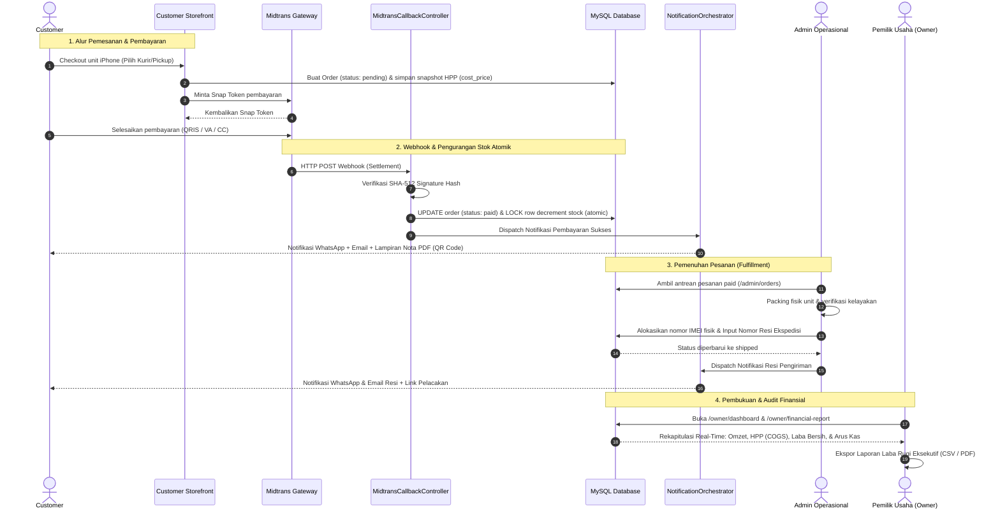
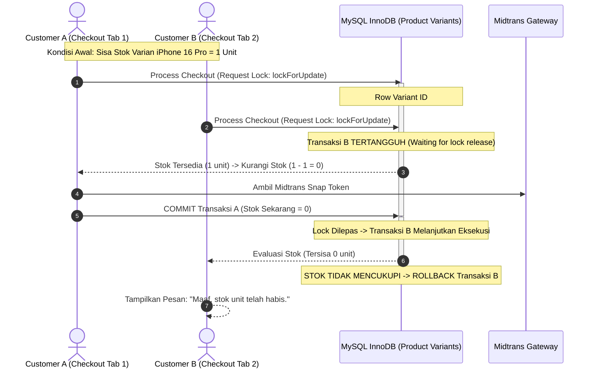

# ARCHITECTURE & SYSTEM BLUEPRINT
## Platform E-Commerce Jual Beli iPhone (Rap-iPhone)

---

### 1. Diagram Arsitektur Sistem

```
+-----------------------------------------------------------------------------------+
|                    CLIENT LAYER (HALLMARK LUXURY RETAIL & EDITORIAL SUITE)        |
|  +---------------------------+  +-----------------------------------------------+  |
|  | Customer Storefront       |  | Admin & Owner Executive Console               |  |
|  | (Hallmark Luxury Retail & |  | (Hallmark Luxury / Editorial Redesign Suite:  |  |
|  |  Studio Precision:       |  |  Sentient Serif, Trade Ledgers, Cotton Stock) |  |
|  |  Sentient, Split Studio)  |  |                                               |  |
|  +---------------------------+  +-----------------------------------------------+  |
|  +-----------------------------------------------------------------------------+  |
|  | Multi-Portal Auth Suite (Fase 35: Hallmark Luxury Retail & Editorial)        |  |
|  |  - Customer /login & /register: Limewash Studio, Sentient, Zero Card-in-Card|  |
|  |  - Admin /admin/login: Store Operations Ledger, Sentient Serif, Hairlines   |  |
|  |  - Owner /owner/login: Executive Financial Portal, Cool Slate Titanium      |  |
|  +-----------------------------------------------------------------------------+  |
+----------------------------------------+------------------------------------------+
                                         | HTTP / HTTPS Requests
                                         v
+-----------------------------------------------------------------------------------+
|                           LARAVEL 12 APPLICATION CORE                             |
|                                                                                   |
|  [ ROUTING & MIDDLEWARE ]                                                         |
|  + web.php, api.php                                                               |
|  + Multi-Portal Auth Routes:                                                      |
|    - Fase 14 Admin   : /admin/login, /admin/logout                                |
|    - Fase 15 Owner   : /owner/login, /owner/logout                                |
|    - Fase 16 Customer: /login, /register, /auth/google, /logout                   |
|  + AuthMiddleware, RoleMiddleware (Contextual Guest Redirect: customer|admin|owner)|
|  + View Composer layouts.admin -> $shell (badge antrean & status integrasi)       |
|  + VerifyCsrfToken (kecuali webhook endpoint api/midtrans/callback)               |
|                                                                                   |
|  [ CONTROLLER LAYER ]                                                             |
|  + Auth\AdminAuthController (Fase 14 — Jalur Login Admin Sendiri)                 |
|  + Auth\OwnerAuthController (Fase 15 — Jalur Login Owner Sendiri)                 |
|  + Auth\AuthController & GoogleAuthController (Fase 16 — Login/Register Customer) |
|  + ProductController & CatalogController                                          |
|  + CartController & CheckoutController                                            |
|  + TradeInController                                                              |
|  + Admin\OrderController, Admin\ProductController, Admin\TradeInController        |
|  + Admin\SystemSettingController (Fase 36 — Monitoring & Diagnostic Probe)        |
|  + Owner\DashboardController, Owner\FinancialReportController                     |
|                                                                                   |
|  [ SERVICE LAYER ]                                                                |
|  + App\Services\MidtransService      -> Snap Token Creation & Status Sync         |
|  + App\Services\FonnteService        -> WhatsApp Notifications API Client         |
|  + App\Services\InvoicePdfService    -> DomPDF Generator Engine                   |
|  + App\Services\NotificationService  -> Multi-channel Orchestrator (WA + Email)   |
|  + App\Services\SystemHealthService  -> Live Gateway Health & Diagnostic Probe    |
|                                                                                   |
|  [ EVENT & LISTENER DISPATCH ]                                                    |
|  + OrderCreatedEvent                 -> Notif WA & Email Tagihan                  |
|  + PaymentSuccessfulEvent            -> Notif WA Lunas + Email + Lampiran Nota PDF|
|  + OrderShippedEvent                 -> Notif WA Resi Pengiriman                  |
+--------------------+---------------------------------------+----------------------+
                     |                                       |
                     v                                       v
+------------------------------------+   +------------------------------------------+
|          DATABASE LAYER            |   |          EXTERNAL INTEGRATIONS           |
|  MySQL (phpMyAdmin)                |   |  + Google Console OAuth 2.0 API          |
|  + users, roles                    |   |  + Midtrans Payment Gateway (Snap API)   |
|  + categories, products, variants  |   |  + Midtrans Webhook (Callback HTTP POST) |
|  + orders, order_items, payments   |   |  + Fonnte WhatsApp Gateway API           |
|  + trade_ins, notification_logs    |   |  + Mail SMTP (Gmail / Mailgun / Brevo)   |
+------------------------------------+   +------------------------------------------+
```

---

### 1.1. Alur Arsitektur & Sekuens Interaksi Antar-Peran (End-to-End Multi-Role Interaction Sequence)

Berikut adalah diagram urutan terpadu yang memetakan pertukaran data dari aksi Customer di Storefront, pemenuhan fisik oleh Admin, hingga audit performa oleh Owner:



---

### 2. Skema Basis Data (Database Schema & Relasi)

#### 2.1. Tabel `users`
| Kolom | Tipe Data | Keterangan |
|---|---|---|
| `id` | BIGINT (PK, Auto Inc) | Primary Key |
| `name` | VARCHAR(255) | Nama lengkap pengguna |
| `email` | VARCHAR(255) (Unique) | Alamat email terverifikasi |
| `password` | VARCHAR(255) (Nullable) | Password hash (nullable jika via Google Login) |
| `google_id` | VARCHAR(255) (Nullable) | Identitas akun Google OAuth |
| `phone_number` | VARCHAR(20) (Nullable) | Nomor WhatsApp (format: 08xx / 628xx) |
| `role` | ENUM('customer','admin','owner') | Default: 'customer' |
| `avatar` | VARCHAR(255) (Nullable) | URL atau path foto profil |
| `address` | TEXT (Nullable) | Alamat utama customer |
| `city` | VARCHAR(100) (Nullable) | Kota/Kabupaten pengiriman |
| `postal_code` | VARCHAR(10) (Nullable) | Kode pos |
| `created_at`, `updated_at` | TIMESTAMP | Waktu pembuatan & modifikasi |

#### 2.2. Tabel `categories` & `products`
**`categories`**:
- `id` (PK), `name` (VARCHAR 100), `slug` (VARCHAR 120), `icon` (VARCHAR 100).

**`products`**:
- `id` (PK, BIGINT)
- `category_id` (FK -> `categories.id`)
- `name` (VARCHAR 255) -> Contoh: *"iPhone 16 Pro Max"*
- `slug` (VARCHAR 255, Unique)
- `series` (VARCHAR 50) -> Contoh: *"iPhone 16 Series"*
- `condition` (ENUM: `'new'`, `'second'`) -> Baru atau Bekas
- `grade` (VARCHAR(10), Nullable) -> `'Grade A+'`, `'Grade A'`, `'Grade B'` (khusus unit second)
- `warranty_type` (ENUM: `'resmi_ibox'`, `'resmi_digimap'`, `'inter_all_operator'`, `'toko'`)
- `base_price` (DECIMAL 12,2) -> Harga awal terendah untuk display
- `description` (LONGTEXT) -> Spesifikasi detail & ketentuan garansi
- `is_active` (BOOLEAN) -> Default `true`
- `created_at`, `updated_at` (TIMESTAMP)

#### 2.3. Tabel `product_variants` & `product_images`
**`product_variants`**:
- `id` (PK, BIGINT)
- `product_id` (FK -> `products.id`, Cascade Delete)
- `storage_capacity` (VARCHAR 20) -> Contoh: *"128GB"*, *"256GB"*, *"512GB"*, *"1TB"*
- `color_name` (VARCHAR 50) -> Contoh: *"Natural Titanium"*, *"Desert Titanium"*
- `color_hex` (VARCHAR 10) -> Kode warna heksadesimal untuk dot color picker
- `cost_price` (DECIMAL 12,2) -> Harga Pokok Penjualan (HPP untuk kalkulasi laba Owner)
- `selling_price` (DECIMAL 12,2) -> Harga jual retail ke customer
- `stock` (INT) -> Sisa kuantitas unit
- `sku` (VARCHAR 100, Unique) -> Kode stok unik
- `battery_health` (INT, Nullable) -> Nilai % kesehatan baterai (khusus second, misal 95%)
- `imei` (VARCHAR 30, Nullable) -> Nomor IMEI fisik (untuk transparansi unit)
- `created_at`, `updated_at` (TIMESTAMP)

**`product_images`**:
- `id` (PK, BIGINT), `product_id` (FK), `variant_id` (FK Nullable), `image_path` (VARCHAR 255), `is_primary` (BOOLEAN), `order_index` (INT).

#### 2.4. Tabel `orders`, `order_items` & `payments`
**`orders`**:
- `id` (PK, BIGINT)
- `order_number` (VARCHAR 50, Unique) -> Contoh: `RAP-20261028-001`
- `user_id` (FK -> `users.id`)
- `total_items_price` (DECIMAL 12,2)
- `shipping_cost` (DECIMAL 12,2)
- `discount_amount` (DECIMAL 12,2, Default 0)
- `grand_total` (DECIMAL 12,2)
- `status` (ENUM: `'pending'`, `'paid'`, `'processing'`, `'shipped'`, `'completed'`, `'cancelled'`)
- `shipping_courier` (VARCHAR 50) -> JNE, SiCepat, J&T, atau Pick-up Toko
- `shipping_tracking_number` (VARCHAR 100, Nullable) -> Nomor resi pengiriman
- `shipping_address` (TEXT)
- `recipient_name` (VARCHAR(150))
- `recipient_phone` (VARCHAR(30))
- `customer_notes` (TEXT, Nullable)
- `created_at`, `updated_at` (TIMESTAMP)

**`order_items`**:
- `id` (PK, BIGINT)
- `order_id` (FK -> `orders.id`, Cascade Delete)
- `product_variant_id` (FK -> `product_variants.id`)
- `product_name` (VARCHAR 255)
- `variant_details` (VARCHAR 255) -> Simpan snapshot: *"Desert Titanium / 256GB"*
- `price` (DECIMAL 12,2)
- `cost_price` (DECIMAL 12,2) -> Snapshot HPP saat transaksi
- `quantity` (INT)
- `subtotal` (DECIMAL 12,2)
- `allocated_imei` (VARCHAR 50, Nullable)

**`payments`**:
- `id` (PK, BIGINT)
- `order_id` (FK -> `orders.id`)
- `midtrans_transaction_id` (VARCHAR 100, Nullable)
- `payment_type` (VARCHAR 50, Nullable) -> `qris`, `bank_transfer`, `gopay`, `credit_card`
- `gross_amount` (DECIMAL 12,2)
- `snap_token` (VARCHAR 255, Nullable)
- `transaction_status` (VARCHAR 50) -> `pending`, `settlement`, `expire`, `deny`, `cancel`
- `payment_time` (TIMESTAMP, Nullable)
- `raw_payload` (JSON, Nullable) -> Payload lengkap dari Midtrans Webhook
- `created_at`, `updated_at` (TIMESTAMP)

#### 2.5. Tabel `trade_ins` (Program Jual / Tukar Tambah iPhone)
- `id` (PK, BIGINT)
- `trade_in_code` (VARCHAR 50, Unique) -> Contoh: `TI-20261028-001`
- `user_id` (FK -> `users.id`)
- `target_order_id` (FK -> `orders.id`, Nullable) -> Terhubung jika dijadikan potongan unit baru
- `phone_model` (VARCHAR 100) -> Contoh: *"iPhone 13 Pro"*
- `storage_capacity` (VARCHAR 20) -> *"128GB"*
- `battery_health` (INT) -> Contoh: 87
- `physical_condition` (VARCHAR 50) -> `'Mulus (Grade A)'`, `'Lecet Pemakaian (Grade B)'`
- `screen_condition` (VARCHAR 50) -> `'Normal'`, `'Ada Jamur/TrueTone Off'`, `'Retak'`
- `accessories_status` (VARCHAR 50) -> `'Fullset Box Original'`, `'Unit Only'`
- `imei` (VARCHAR 30, Nullable)
- `estimated_price` (DECIMAL 12,2) -> Harga taksiran otomatis sistem
- `final_price` (DECIMAL 12,2, Nullable) -> Harga deal setelah inspeksi admin di toko
- `status` (ENUM: `'submitted'`, `'unit_received'`, `'inspected'`, `'approved'`, `'rejected'`, `'paid_out'`)
- `customer_bank_name` (VARCHAR 50, Nullable)
- `customer_account_number` (VARCHAR 50, Nullable)
- `customer_account_holder` (VARCHAR 100, Nullable)
- `admin_notes` (TEXT, Nullable)
- `created_at`, `updated_at` (TIMESTAMP)

#### 2.6. Tabel `notifications_log`
- `id` (PK, BIGINT)
- `channel` (ENUM: `'whatsapp'`, `'email'`)
- `recipient` (VARCHAR 150) -> Nomor HP / Email
- `event_name` (VARCHAR 100) -> `order_created`, `payment_success`, `order_shipped`
- `status` (ENUM: `'sent'`, `'failed'`)
- `error_message` (TEXT, Nullable)
- `response_payload` (JSON, Nullable)
- `created_at` (TIMESTAMP)

#### 2.7. Model Rekonsiliasi & Pipeline Finansial (Financial Metrics Engine)
Dijalankan oleh `App\Services\FinancialAnalyticsService` untuk merekap data keuangan riil pesanan berstatus *realized* (`paid`, `processing`, `shipped`, `completed`):

1. **Penjualan Kotor Produk (*Gross Items Sales*)**:
   $$\text{Gross Sales} = \sum (\text{item.price} \times \text{item.quantity})$$
2. **Total Harga Pokok Penjualan (*Total Cost of Goods Sold / COGS*)**:
   $$\text{COGS} = \sum (\text{item.cost\_price} \times \text{item.quantity})$$
3. **Laba Kotor Produk (*Gross Profit*)**:
   $$\text{Gross Profit} = \text{Gross Sales} - \text{COGS}$$
4. **Laba Bersih Toko (*Net Profit*)**:
   $$\text{Net Profit} = \text{Gross Profit} - \sum \text{order.discount\_amount}$$
5. **Rasio Margin Laba Bersih (*Net Profit Margin %*)**:
   $$\text{Margin \%} = \frac{\text{Net Profit}}{\text{Total Revenue}} \times 100\%$$
6. **Arus Kas Bersih (*Net Cash Flow*)**:
   $$\text{Net Cash Flow} = \text{Revenue Masuk} - \text{Total Kas Keluar Trade-In}$$

---

### 3. Arsitektur Integrasi Layanan (Service Layer)

```
app/
├── Http/
│   ├── Controllers/
│   │   ├── Auth/
│   │   │   ├── AdminAuthController.php   <-- Fase 14: Jalur Login Admin Sendiri (/admin/login)
│   │   │   ├── OwnerAuthController.php   <-- Fase 15: Jalur Login Owner Sendiri (/owner/login)
│   │   │   ├── AuthController.php        <-- Fase 16: Jalur Login & Register Customer (/login, /register)
│   │   │   └── GoogleAuthController.php  <-- Fase 16: Google OAuth Khusus Customer (Socialite)
│   │   ├── Customer/
│   │   │   ├── HomeController.php
│   │   │   ├── CatalogController.php
│   │   │   ├── CartController.php
│   │   │   ├── CheckoutController.php
│   │   │   ├── OrderHistoryController.php
│   │   │   └── TradeInCustomerController.php
│   │   ├── Admin/
│   │   │   ├── ProductManagementController.php
│   │   │   ├── OrderManagementController.php
│   │   │   ├── TradeInVerificationController.php
│   │   │   └── SystemSettingController.php     <-- Fase 36: Konfigurasi Sistem & Live API Monitoring
│   │   ├── Owner/
│   │   │   ├── ExecutiveDashboardController.php
│   │   │   ├── FinancialReportController.php
│   │   │   └── StaffManagementController.php
│   │   └── Api/
│   │       └── MidtransCallbackController.php  <-- Webhook Handler
│   └── Middleware/
│       └── RoleMiddleware.php                  <-- RBAC Guard & Contextual Portal Redirect
├── Models/
│   ├── User.php
│   ├── Product.php
│   ├── ProductVariant.php
│   ├── Order.php
│   ├── OrderItem.php
│   ├── Payment.php
│   └── TradeIn.php
├── Services/
│   ├── MidtransService.php         <-- Generate Snap Token & Cek Status
│   ├── FonnteService.php           <-- Kirim Pesan WhatsApp via Fonnte API
│   ├── InvoicePdfService.php       <-- Render Nota PDF DomPDF
│   ├── NotificationOrchestrator.php<-- Trigger WA + Email serentak
│   └── SystemHealthService.php     <-- Fase 36: Live Connection Probe Engine & Diagnostic Runner
└── Mail/
    ├── OrderInvoiceMail.php        <-- Mailable dengan attachment Nota PDF
    └── PaymentConfirmedMail.php
```

---

### 4. Spesifikasi Integrasi API Pihak Ketiga

#### 4.1. Google Console OAuth 2.0 (Laravel Socialite — Khusus Customer Fase 16)
- **Library**: `laravel/socialite`
- **Redirect URI**: `https://domain.com/auth/google/callback`
- **Logika Autentikasi Pelanggan**:
  1. Pelanggan klik "Masuk dengan Google" atau "Daftar 1-Klik dengan Google" pada halaman `/login` atau `/register`.
  2. Redirect ke Google Consent Screen.
  3. Callback menerima token dan profil: `email`, `name`, `id`, `avatar`.
  4. Cari user berdasarkan `google_id` atau `email`.
  5. **Isolasi Role (`Fase 16`)**: Jika akun yang ditemukan memiliki role `admin` atau `owner`, proses login Google ditolak dan diarahkan untuk masuk melalui portal internal (`/admin/login` atau `/owner/login`).
  6. Jika user `customer` sudah ada, sinkronkan `google_id` dan *login*. Jika belum, buat record baru dengan role `customer`.

#### 4.2. Midtrans Payment Gateway (Snap API & Callback)
- **Library**: `midtrans/midtrans-php`
- **Konfigurasi `.env`**:
  - `MIDTRANS_SERVER_KEY=...`
  - `MIDTRANS_CLIENT_KEY=...`
  - `MIDTRANS_IS_PRODUCTION=false`
  - `MIDTRANS_IS_SANITIZED=true`
  - `MIDTRANS_IS_3DS=true`
- **Pembuatan Token Snap**:
  - Dikirim saat customer menekan "Lanjut ke Pembayaran" di halaman checkout.
  - Memuat rincian `transaction_details`, `item_details`, dan `customer_details`.
  - Frontend memanggil fungsi `snap.pay(snapToken)`.
- **Penanganan Webhook (`/api/midtrans/callback`)**:
  - Mengabaikan proteksi CSRF di middleware.
  - **Validasi Keamanan**: Membuat hash verifikasi:
    `hash('sha512', $orderId . $statusCode . $grossAmount . $serverKey)`
    Status hanya diupdate bila signature hash cocok dengan kiriman header Midtrans.
  - Update status pesanan:
    - `settlement` / `capture (accept)` -> Status `paid`.
    - `pending` -> Tetap `pending`.
    - `deny` / `expire` / `cancel` -> Status `cancelled`.
  - Trigger *NotificationOrchestrator* untuk mengirim WhatsApp & Email bukti pembayaran.

#### 4.3. Notifikasi WhatsApp (Fonnte API)
- **Endpoint**: `https://api.fonnte.com/send`
- **Header Autentikasi**: `Authorization: {FONNTE_API_TOKEN}`
- **Fungsi Layanan**:
  - Format nomor telepon otomatis disesuaikan ke format internasional (`628xxx`).
  - Template pesan dinamis:
    - Tagihan pesanan baru & detail rekening / tautan pembayaran.
    - Konfirmasi pembayaran sukses beserta ringkasan unit iPhone & nomor nota.
    - Pembaruan nomor resi logistik saat paket dikirim.
    - Notifikasi taksiran & persetujuan unit tukar tambah.

#### 4.4. Generator Nota PDF (DomPDF)
- **Library**: `barryvdh/laravel-dompdf`
- **Desain Template**: Desain faktur resmi bergaya Apple Authorized Partner:
  - Header: Logo Rap-iPhone, Alamat Store, Kontak Resmi, Nomor NPWP/Izin Usaha.
  - Metadata: Nomor Nota unik, Tanggal & Jam Transaksi, Nama Kasir/Sistem, Metode Pembayaran.
  - Rincian Produk: Seri iPhone, Varian Warna, Kapasitas, Nomor IMEI Unit, Status Garansi, Harga Satuan, Diskon, Total.
  - QR Code Validasi Keaslian Nota.
  - Syarat & Ketentuan Klaim Garansi Toko & Garansi Resmi.

#### 4.5. Sistem Pemantauan Konektivitas & Diagnostik API Real-Time (System Health & API Monitoring Suite — Fase 36)
- **Service Engine**: `App\Services\SystemHealthService`
- **Controller Admin**: `App\Http\Controllers\Admin\SystemSettingController`
- **Tujuan Arsitektur**: Mengubah pengecekan statis `.env` menjadi sistem pemantauan aktif yang mampu melakukan *live connection probe* (dengan batasan network timeout 3 detik), pengukuran latensi respon (ms), diagnosis pesan error HTTP/Socket, serta agregasi status infrastruktur runtime ke antarmuka Admin & Owner.

1. **Spesifikasi Probe Gateway Pihak Ketiga**:
   - **Midtrans Payment Gateway**:
     - *Endpoint Probe*: `GET {baseUrl}/v2/token` dengan header `Authorization: Basic {base64(serverKey + ':')}`.
     - *Status Evaluasi*: `connected` (HTTP 200, 400, 404 menandakan gateway online & responsif), `invalid_credentials` (HTTP 401 Unauthorized), `offline` (Connection Timeout/DNS failure).
   - **WhatsApp Fonnte Gateway**:
     - *Endpoint Probe*: `POST https://api.fonnte.com/device` dengan header `Authorization: {token}`.
     - *Status Evaluasi*: `connected` (HTTP 200 dengan `device_status: connect`), `disconnected` (device offline/scan QR needed), `invalid_credentials` (HTTP 401/token salah), `simulation` (kredensial belum diset).
   - **SMTP Mailer Transport**:
     - *Socket Probe*: Handshake socket TCP ke `config('mail.mailers.smtp.host')` pada port `config('mail.mailers.smtp.port')` via `fsockopen` (timeout 3 detik).
     - *Status Evaluasi*: `connected` (socket terbuka dan banner greeting `220` terbaca), `simulation` (jika driver `log` atau `array`), `offline` (koneksi ditolak / port timeout).
   - **Google Console OAuth 2.0 (Socialite)**:
     - *Discovery Probe*: `GET https://accounts.google.com/.well-known/openid-configuration`.
     - *Status Evaluasi*: `connected` (HTTP 200 dan endpoint OpenID terbaca dengan Client ID valid), `ready` (siap dikonfigurasi), `offline` (koneksi timeout).

2. **Endpoint & Kontrak Data API Diagnostik**:
   - `GET /admin/settings` -> Merender halaman dashboard konfigurasi dan log notifikasi.
   - `POST /admin/settings/test/{gateway}` -> Mengembalikan respon JSON:
     ```json
     {
       "key": "midtrans",
       "name": "Midtrans Payment Gateway (Snap API & Webhook)",
       "configured": true,
       "mode": "Sandbox Mode",
       "status": "connected",
       "latency_ms": 118,
       "message": "Koneksi API Midtrans terhubung aktif (118ms)"
     }
     ```

3. **Sinkronisasi Shell View Composer (`AppServiceProvider`)**:
   - Menyediakan data status 4 gateway secara terpusat untuk topbar masthead panel Admin (`layouts.admin`) dan Owner (`layouts.admin`), sehingga staf dan pemilik usaha mendapatkan peringatan visual instan jika salah satu gateway pihak ketiga mengalami disrupsi.

---

### 5. Keamanan Sistem, Kepatuhan ACID & Mitigasi Konkurensi Enterprise (Fase 34)

Untuk menjamin keandalan transaksi finansial dan integritas sistem berskala produksi, platform Rap-iPhone menerapkan prinsip-prinsip keamanan berlapis (*defense-in-depth*), kepatuhan transaksi database ACID, mitigasi IDOR berbasis kebijakan, serta kontrol konkurensi terhadap *race conditions*:

#### 5.1. Matriks Mitigasi IDOR (Insecure Direct Object Reference) & Otorisasi Ketat
Kerentanan IDOR dicegah pada seluruh titik masuk (*entrypoints*) melalui otorisasi deklaratif pada level Controller dan Policy Eloquent:

| Entitas / Endpoint | Potensi Celah IDOR | Mekanisme Mitigasi & Penegakan Kebijakan | Respon Pelanggaran |
|---|---|---|:---:|
| **Detail Pesanan Pelanggan**<br>`GET /checkout/success/{order:order_number}` | Akses URL nota pesanan milik pelanggan lain dengan mengubah nomor pesanan | Pemeriksaan kepemilikan eksplisit: `$order->user_id === auth()->id()`. Pengguna lain ditolak seketika. | `403 Forbidden` |
| **Unduh & Preview Faktur PDF**<br>`GET /orders/{order:order_number}/invoice` | Unduh file faktur PDF berisi data PII dan nomor IMEI milik pelanggan lain | Otorisasi via `OrderPolicy@downloadInvoice`: Admin & Owner diizinkan; Customer hanya untuk `order.user_id === auth()->id()` berstatus lunas (`paid`, `shipped`, `completed`). | `403 Forbidden` |
| **Pengajuan Tukar Tambah**<br>`GET /trade-in/{tradeIn:trade_in_code}` | Melihat hasil taksiran unit dan data rekening bank customer lain | Otorisasi via `TradeInPolicy@view`: Customer hanya dapat mengakses unit miliknya sendiri (`tradeIn.user_id === auth()->id()`). Admin/Owner memiliki akses inspeksi. | `403 Forbidden` |
| **Riwayat Transaksi Pribadi**<br>`GET /customer/orders` | Menginjeksi parameter filter untuk melihat pesanan pengguna lain | Query database dibatasi secara absolut menggunakan user context: `Order::where('user_id', auth()->id())` dan `TradeIn::where('user_id', auth()->id())`. | `Data Terisolasi` |
| **Ekskalasi Hak Akses Admin/Owner**<br>`/owner/*` & `/admin/*` | Pengguna biasa memanggil rute eksekutif atau admin mengubah staf owner | Proteksi `RoleMiddleware` berjenjang; larangan bagi Owner menghapus akun dirinya sendiri atau menurunkan rolenya saat sedang aktif di `StaffManagementController`. | `403 Forbidden` |

#### 5.2. Desain Transaksi Database ACID & Batas Transaksional Multi-Tabel
Seluruh operasi basis data yang melibatkan perubahan nilai moneter, status pesanan, dan kuantitas inventaris dikelola dengan prinsip **ACID**:

1. **Atomicity (Semua Berhasil atau Semua Dibatalkan)**:
   - **Alur Pembuatan Pesanan (`CheckoutController::process`)**:
     Pembuatan *Order*, pembuatan seluruh record *OrderItems* (snapshot HPP & IMEI), pengaitan kupon *Trade-In* (`target_order_id`), serta inisialisasi record *Payment* dibungkus dalam blok `DB::transaction()`. Jika salah satu entitas gagal dibuat atau API Midtrans mengembalikan error fatal, database melakukan *rollback* 100% sehingga tidak ada data yatim (*orphan records*).
   - **Alur Pelunasan Webhook Midtrans (`MidtransCallbackController::handle`)**:
     Pembaruan status order menjadi `paid`, pengurangan stok seluruh varian, dan pencatatan riwayat webhook dijalankan dalam transaksi atomik tunggal.
   - **Alur Inspeksi & Approval Tukar Tambah (`TradeInVerificationController`)**:
     Penetapan harga final, penerbitan kode voucher toko unik, dan perubahan status pengajuan terikat dalam satu blok transaksi database.
2. **Consistency (Integritas Data Sesuai Aturan Bisnis)**:
   - Integritas referensial relasi antar tabel ditegakkan melalui *Foreign Key Constraints* (MySQL InnoDB).
   - *Stock Non-Negative Constraint*: Nilai kolom `stock` pada `product_variants` divalidasi tidak boleh kurang dari 0 (`max(0, stock - qty)` dan pengecekan klausa `where('stock', '>=', $qty)`).
   - Invariant State Machine: Pesanan tidak dapat berpindah dari `pending` langsung ke `shipped` tanpa status perantara `paid`.
3. **Isolation (Isolasi Transaksi Konkuren)**:
   - Menggunakan mesin basis data **InnoDB** dengan tingkat isolasi default `REPEATABLE READ`.
   - Menerapkan *pessimistic row-level locking* (`lockForUpdate()`) pada baris varian produk dan voucher trade-in saat transaksi dieksekusi guna mencegah anomali *dirty read*, *non-repeatable read*, dan *lost update*.
4. **Durability (Ketahanan & Permanensi Data)**:
   - Data yang telah di-*commit* tersimpan permanen pada disk fisik MySQL melalui mekanisme *Write-Ahead Logging* (WAL InnoDB `ib_logfile`) dan *Doublewrite Buffer*, aman dari kegagalan daya atau *crash* mendadak.

#### 5.3. Pencegahan Race Condition & Concurrency Control
Pada saat terjadi lonjakan trafik tinggi (*flash sale* iPhone seri terbaru atau klaim promo serentak), sistem menerapkan strategi penguncian baris data (*pessimistic locking*) untuk mencegah *overselling* stok dan *double-spending* kupon:



1. **Pencegahan Overselling Inventaris (Flash-Sale Stock Protection)**:
   - Saat checkout dan saat webhook settlement, sistem memanggil query:
     ```php
     $variant = ProductVariant::where('id', $item->product_variant_id)
         ->lockForUpdate()
         ->first();
     ```
   - Pengurangan stok dilakukan menggunakan query atomik yang menjamin kuantitas tidak negatif:
     ```php
     ProductVariant::where('id', $variantId)
         ->where('stock', '>=', $quantity)
         ->decrement('stock', $quantity);
     ```
   - Jika baris yang terpengaruh (*affected rows*) bernilai 0, sistem langsung menggugurkan transaksi dan melempar *insufficient stock exception*.
2. **Pencegahan Double-Spending Voucher Trade-In**:
   - Jika pelanggan mencoba menggunakan voucher tukar tambah yang sama pada 2 sesi atau tab browser secara bersamaan, baris voucher dikunci menggunakan:
     ```php
     $tradeIn = TradeIn::where('customer_account_number', $voucherCode)
         ->whereIn('status', ['approved', 'paid_out'])
         ->whereNull('target_order_id')
         ->lockForUpdate()
         ->first();
     ```
   - Begitu transaksi pertama mengaitkan voucher ke order (`target_order_id = $order->id`), transaksi kedua yang antre akan mendapati `whereNull('target_order_id')` bernilai kosong dan seketika menolak penggunaan voucher ganda.
3. **Idempotensi Webhook Callback Midtrans**:
   - Webhook yang dikirim berulang kali untuk status yang sama (*retried HTTP POST*) diverifikasi secara idempotent:
     ```php
     $order = Order::where('order_number', $orderId)->lockForUpdate()->first();
     if ($order->status === 'paid' && $targetStatus === 'paid') {
         return response()->json(['status' => 'success', 'message' => 'Idempotent (Already paid).'], 200);
     }
     ```
   - Menghindari pemotongan stok ganda (*double stock decrement*) dan duplikasi pengiriman notifikasi WhatsApp/Email ke pelanggan.

#### 5.4. Tata Kelola Sesi & Proteksi Brute-Force Multi-Portal (Defense-in-Depth)
1. **Isolasi Rate Limiting Anti-Brute-Force**:
   - `/admin/login`: `throttle:5,1` (Maksimal 5 percobaan gagal per menit per kombinasi email/IP).
   - `/owner/login`: `throttle:3,1` (Maksimal 3 percobaan gagal per menit).
   - `/login` & `/register`: `throttle:10,1` (Maksimal 10 percobaan per menit).
   - `/verifikasi-nota/{orderNumber}/{code}`: `throttle:30,1` (Maksimal 30 permintaan per menit untuk mencegah *scraping* atau *brute-force enumeration*).
2. **Mitigasi Session Fixation & Hijacking**:
   - Pemanggilan wajib `$request->session()->regenerate()` pada setiap proses masuk (*login*) berhasil di seluruh portal.
   - Pemanggilan `$request->session()->invalidate()` dan `$request->session()->regenerateToken()` pada saat keluar (*logout*).
   - Konfigurasi cookie sesi aman (`config/session.php`):
     - `http_only => true` (Mencegah pencurian cookie sesi via serangan XSS).
     - `same_site => 'lax'` (Mencegah serangan CSRF lintas-situs).
     - `secure => env('APP_ENV') === 'production'` (Menjamin cookie hanya ditransmisikan melalui HTTPS).

#### 5.5. Integritas Kriptografis, Anti-Tampering & Pertahanan Aplikasi Web
1. **Verifikasi Tanda Tangan Webhook**:
   - Validasi SHA-512 Signature Hash pada header callback Midtrans:
     $$\text{Signature} = \text{SHA512}(\text{order\_id} + \text{status\_code} + \text{gross\_amount} + \text{server\_key})$$
   - Request callback tanpa signature yang cocok langsung ditolak dengan respon `403 Forbidden`.
2. **Integritas Nota Faktur PDF & Verifikasi QR Code**:
   - Kode verifikasi unik pada setiap nota di-generate secara deterministik dan tahan manipulasi (*tamper-proof*) menggunakan HMAC-SHA256:
     ```php
     $verificationCode = hash_hmac('sha256', "{$order->order_number}|{$order->grand_total}|{$order->created_at->timestamp}", config('app.key'));
     ```
   - Mengubah parameter nomor pesanan atau nominal pada URL nota secara otomatis menggugurkan keabsahan faktur pada halaman verifikasi.
3. **Penyamaran Data Privasi Pelanggan (PII Masking)**:
   - Halaman verifikasi publik `/verifikasi-nota/{orderNumber}/{code}` secara otomatis menyamarkan nama pemesan (`B*** S***`) dan nomor telepon (`0812****890`) guna mematuhi prinsip perlindungan privasi data pribadi (*Data Privacy Protection*).
4. **Header Keamanan HTTP (`SecurityHeadersMiddleware`)**:
   - `X-Frame-Options: SAMEORIGIN` (Mencegah serangan Clickjacking).
   - `X-Content-Type-Options: nosniff` (Mencegah eksploitasi MIME-type sniffing).
   - `X-XSS-Protection: 1; mode=block` (Mengaktifkan filter XSS peramban).
   - `Referrer-Policy: strict-origin-when-cross-origin`.
5. **Validasi & Pengamanan Upload Berkas**:
   - Validasi ketat pada berkas unggahan foto varian dan fisik trade-in: hanya menerima format MIME `image/jpeg`, `image/png`, `image/webp` dengan batasan ukuran berkas maksimum 3MB.
   - Penamaan file otomatis diobfuskasi dengan hash kriptografis `Str::random(40) . '.' . $extension` untuk mencegah *Path Traversal* (`../../`) dan eksekusi skrip berbahaya (*Arbitrary PHP Shell Upload*).

#### 5.6. Role-Based Access Control (RBAC) & Arsitektur Login Terpisah (Fase 14, 15, & 16)
   - Diterapkan melalui `RoleMiddleware` dan 3 pengontrol autentikasi mandiri yang memisahkan pintu masuk (*login pathway*) berdasarkan role:

| Fase | Peran (Role) | Endpoint Login & Register | Controller Penangan | Validasi & Isolasi Role | Target Redirect Utama |
|---|---|---|---|---|---|
| **Fase 14** | **Admin Operasional** (`admin`) | `GET/POST /admin/login`<br>`POST /admin/logout` | `AdminAuthController` | Wajib `role === 'admin'` (Menolak `customer` & `owner` di pintu ini; tanpa Google OAuth & tanpa Register) | `/admin/dashboard` |
| **Fase 15** | **Pemilik Usaha** (`owner`) | `GET/POST /owner/login`<br>`POST /owner/logout` | `OwnerAuthController` | Wajib `role === 'owner'` (Menolak `admin` & `customer` di pintu ini; tanpa Google OAuth & tanpa Register) | `/owner/dashboard` |
| **Fase 16** | **Pelanggan** (`customer`) | `GET/POST /login`<br>`GET/POST /register`<br>`GET /auth/google` | `AuthController` & `GoogleAuthController` | Wajib `role === 'customer'` (Menolak `admin` & `owner` di pintu publik pelanggan; dilengkapi Register mandiri & Google OAuth) | `/` (atau halaman checkout/intended) |

   - **Contextual Guest Redirection pada `RoleMiddleware`**:
     - Pengguna belum login (*guest*) yang mengakses `/admin/*` diarahkan ke `route('admin.login')` (`/admin/login`).
     - Pengguna belum login (*guest*) yang mengakses `/owner/*` diarahkan ke `route('owner.login')` (`/owner/login`).
     - Pengguna belum login (*guest*) yang mengakses `/customer/*` atau `/checkout/*` diarahkan ke `route('login')` (`/login`).

---

### 6. Arsitektur Frontend & Design System v2.0 (Mode ATM Digimap — `redesign.md`)

Mengacu pada spesifikasi di `projekiphone/redesign.md`, lapisan presentasi (*Presentation Layer*) bertransformasi dari tema gelap ke **Digimap-Inspired Daylight Minimalist & Frosted White UI** (`https://www.digimap.co.id/`):

#### 6.1. Struktur Token CSS & Lapisan Visual (`resources/css/`)
- **Palet Daylight Retail**:
  - `--dm-canvas: #FFFFFF` (Latar utama halaman)
  - `--dm-surface: #F5F5F7` (Permukaan kartu produk, bento promo, input form, & panel spesifikasi)
  - `--dm-glass-white: rgba(255, 255, 255, 0.84)` dengan `backdrop-filter: blur(20px)` (Sticky Header, Sticky Bottom Buy Bar, & Modal Overlay)
  - `--dm-text-primary: #1D1D1F`, `--dm-text-secondary: #6E6E73`, `--dm-border: #D2D2D7`, `--dm-blue-cta: #0071E3`
- **Kompatibilitas Utility Class**:
  - Class `.glass-card`, `.glass-navbar`, `.glass-button`, dan `.glass-modal` diperbarui secara terpusat agar merender permukaan *Clean White & Warm Gray* dengan *hairline border* halus (`1px solid #E5E5EA`) dan bayangan lembut (`0 4px 20px rgba(0, 0, 0, 0.04)`).

#### 6.2. Hierarki Layout & Komponen Blade (`resources/views/`)
```
resources/views/
├── layouts/
│   ├── customer.blade.php       <-- Top Promo Ticker + Sticky Daylight Header + Digimap Footer
│   └── admin.blade.php          <-- Digimap Enterprise Clean Light Sidebar & Topbar
├── auth/                        <-- Fase 35: Hallmark Luxury Editorial & Studio Redesign Multi-Portal Suite
│   ├── login.blade.php          <-- Fase 35: Customer Login Studio Precision (Sentient Serif, Token --cust-*, Google OAuth)
│   ├── register.blade.php       <-- Fase 35: Customer Registration Form Terstruktur & Zero Card-in-Card
│   ├── admin-login.blade.php    <-- Fase 35: Admin Operations Ledger Login (Sentient Serif, Token --adm-*, Inline Demo Chip)
│   └── owner-login.blade.php    <-- Fase 35: Owner Executive Financial Portal Login (Titanium Accent, Token --adm-*)
├── components/
│   ├── customer/                <-- Fase 25: product-card, spec-badge, button, color-swatch, battery-health-meter, section-header
│   ├── admin/                   <-- Fase 17: page-header, stat-card, card, empty-state, status-badge
│   ├── product-card.blade.php   <-- Legacy wrapper kompatibilitas
│   ├── glass-card.blade.php     <-- Kontainer permukaan putih/abu terang bersih
│   ├── glass-button.blade.php   <-- Pill/Rounded CTA (#0071E3 & #1D1D1F)
│   ├── order-badge.blade.php    <-- Semantic badges kontras tinggi di atas latar putih
│   └── battery-meter.blade.php  <-- Indikator Battery Health untuk unit Second Like New
├── admin/                       <-- Fase 17–20 & 24: dashboard, products/*, orders/*, trade-ins/*, settings
├── owner/                       <-- Fase 21–23: dashboard (+ partials/*), financial-report, staff/index
└── customer/
    ├── home.blade.php           <-- Fase 26: Hero Offer Flagship + Series Icon Ribbon + Bento Grid
    ├── catalog.blade.php        <-- Fase 27: Macrostructure Catalogue (11) + Dual-Condition Filter
    ├── pdp.blade.php            <-- Fase 28: Macrostructure Split Studio (15) + Configurator + Sticky Buy Bar
    ├── cart.blade.php           <-- Fase 29: Spec Sheet Item Ledger & Estimasi Potongan Trade-In
    ├── checkout.blade.php       <-- Fase 29: Two-Column Distraction-Free + Midtrans Snap Modal
    ├── trade-in.blade.php       <-- Fase 30: 4-Step Narrative Workflow Wizard Tukar Tambah
    ├── trade-in-detail.blade.php<-- Fase 30: Status & Timeline Inspeksi Unit Trade-In
    ├── orders.blade.php         <-- Fase 31: Buku Besar Transaksi Customer & Tracking Resi
    ├── checkout-success.blade.php<-- Fase 31: Bukti Pembayaran Lunas & Tombol Unduh Nota PDF
    └── utilities.blade.php      <-- Cek IMEI Kemenperin & Garansi Resmi Unit
```

#### 6.3. Hallmark Luxury / Editorial Design System (Fase 17–24)
Lapisan presentasi panel Admin Operasional dan Pemilik Usaha (Owner) ditransformasi menggunakan kerangka kerja **Hallmark Redesign** dengan tone **Luxury / Editorial** (genre: `editorial`). Desain memadukan ketenangan buku besar retail mewah (*trade ledger*), kertas limewash, tipografi display serif berbobot ringan, serta disiplin ketat aturan *The Floor* dari Hallmark.

**a. Spesifikasi Token CSS (`resources/css/admin.css` & `tokens.css`)**
Seluruh warna, tipografi, dan spasi diwajibkan melewati token CSS deklarasi `:root` tanpa nilai literal di dalam view:

```css
:root {
  /* Palet Kertas & Permukaan (Limewash & Cotton Stock) */
  --adm-paper: oklch(96% 0.008 80);        /* Kanvas limewash alabaster hangat (#FBFBFA) */
  --adm-paper-subtle: oklch(94% 0.010 78); /* Seksi sekunder / tabel background (#F5F4F0) */
  --adm-surface: #FFFFFF;                  /* Permukaan kartu cotton card stock */
  
  /* Tinta & Keterbacaan (Obsidian & Pencilled Slate) */
  --adm-ink: oklch(19% 0.024 52);          /* Tinta utama judul dan angka (#141413) */
  --adm-ink-muted: oklch(47% 0.014 60);    /* Teks sekunder pencilled (#6B6864) */
  --adm-ink-faint: oklch(65% 0.010 65);    /* Label wall-text dan caption (#9E9B95) */
  
  /* Garis Pembatas (Hairlines & Double Rules) */
  --adm-rule-hair: 1px solid oklch(88% 0.008 75); /* Pembatas baris hairline halus (#E5E2DC) */
  --adm-rule-head: 1px solid var(--adm-ink);      /* Garis kepala seksi / tabel */
  --adm-rule-double: 3px double var(--adm-ink);   /* Garis ganda buku kas master ledger */
  
  /* Aksen Tunggal & Fokus */
  --adm-accent: oklch(41% 0.075 248);      /* Cool Slate Titanium (#2C353D) */
  --adm-accent-soft: oklch(93% 0.02 248);  /* Latar badge tenang / hover row */
  --adm-focus: var(--adm-accent);          /* Ring fokus keyboard :focus-visible */
  
  /* Tipografi Editorial */
  --adm-font-display: "Sentient", "Playfair Display", Georgia, serif;
  --adm-font-body: "Hanken Grotesk", "Inter", -apple-system, sans-serif;
  --adm-tracking-display: -0.018em;
  --adm-display-weight: 300;               /* Bobot ringan serif elegan */
  
  /* Geometri & Sudut */
  --adm-radius: 2px;                       /* Sudut presisi ala buku cetak, tanpa sudut bulat balon */
  --adm-shadow: 0 1px 3px rgba(20, 20, 19, 0.04);
}
```

**b. Kelas Utility Utama (`resources/css/admin.css`)**

| Kelas | Karakteristik Visual Editorial & Fungsinya |
|---|---|
| `.adm-page` | Kontainer utama halaman, `max-width: 1440px`, padding lega, terikat `overflow-x: clip` |
| `.adm-page-header` | Kepala halaman editorial: judul serif display (`--adm-font-display`), subjudul satu kalimat terukur |
| `.adm-card` | Kartu *cotton stock* putih bersih dengan garis pembatas *hairline* `1px`, radius `2px`, tanpa bayangan tebal |
| `.adm-stat` | Panel *Statement Number*: angka moneter/volume serif ukuran besar, label pencilled untracked di bawahnya |
| `.adm-toolbar` | Baris kontrol bergaris tipis, pemilih status pill minimalis, dan kolom pencarian tanpa ornamen |
| `.adm-table` | Format *Master Trade Ledger*: kepala tabel bergaris ganda (`--adm-rule-double`), baris bergaris tipis, hover wash lembut |
| `.adm-num` | Angka moneter dan kuantitas rata kanan dengan font tubuh `tabular-nums` |
| `.adm-field`, `.adm-input` | Kontrol form dengan garis batas presisi 1px, state focus ring seketika (`:focus-visible`) |
| `.adm-badge` | Badge stempel (*editorial stamp*): berbingkai halus 1px, latar lembut monokromatik/semantik tenang |
| `.adm-empty` | State kosong bersahaja dengan deskripsi singkat tanpa ilustrasi kartun generik |

**c. Komponen Reusable Blade (`resources/views/components/admin/`)**
1. `<x-admin.page-header>`: Slot judul serif, subjudul satu kalimat terukur, dan aksi bergaris tinta (*hairline-outlined controls*).
2. `<x-admin.stat-card>`: Menampilkan angka metrik format *Statement Figure* bersahaja yang jujur dari database.
3. `<x-admin.card>`: Kontainer permukaan kertas bertekstur halus untuk membungkus konten formulir atau tabel.
4. `<x-admin.table>`: Tabel data dengan struktur *Trade Ledger* berstandar akuntansi presisi.
5. `<x-admin.status-badge>`: Label status transaksi (*paid*, *processing*, *shipped*, *completed*, *cancelled*) dengan gaya cap stempel kurasi.
6. `<x-admin.empty-state>`: Pesan ketiadaan data yang ringkas dan faktual.

**d. Tata Kelola Layout (`layouts/admin.blade.php`)**
- **Pemuatan Aset Font Eksekutif**:
  ```html
  <link href="https://api.fontshare.com/v2/css?f[]=sentient@300,400&display=swap" rel="stylesheet">
  <link href="https://fonts.googleapis.com/css2?family=Hanken+Grotesk:wght@400;500;600&display=swap" rel="stylesheet">
  ```
- **Masthead Topbar**: Latar limewash dengan garis bawah 1px, jam operasional lokal presisi, breadcrumb ringan, dan indikator status API Midtrans & Fonnte berbasis data riil `$shell`.
- **Editorial Sidebar (Lebar 260px)**: Navigasi vertikal dengan garis pembatas halus, nomor antrean pesanan & trade-in ditampilkan sebagai nomor edisi (*pencilled edition count*), tanpa icon berwarna-warni norak.
- **Transisi & Animasi**: Bebas dari `transition: all`; hanya transisi properti terukur (`opacity`, `transform`, `background-color`) maksimal 150ms dengan fallback `@media (prefers-reduced-motion: reduce)`.

**e. Pola Halaman Baku**
`Page Header Editorial` $\rightarrow$ `Statement Stat Row` (opsional) $\rightarrow$ `Toolbar / Ledger Tabs` $\rightarrow$ `Trade Ledger Table / Cotton Form Card`. Diterapkan konsisten di:
- Admin: `/admin/dashboard`, `/admin/products/*`, `/admin/orders/*`, `/admin/trade-ins/*`, `/admin/settings`.
- Owner: `/owner/dashboard`, `/owner/financial-report`, `/owner/staff`.

#### 6.4. Fitur Interaktif Frontend (JavaScript / Vanilla DOM)
1. **Dynamic Variant & Price Switcher (PDP & Product Card)**:
   - Mengubah gambar aktif saat *Color Swatch* diklik dan memperbarui harga utama serta nominal simulasi cicilan per bulan secara instan saat *Storage Pill* (`128GB`–`1TB`) dipilih.
2. **Inline Trade-In Price Slasher (PDP)**:
   - Menghitung harga bersih (*Net Payable Price*) di halaman produk ketika pelanggan memilih model iPhone lama mereka sebagai tukar tambah.
3. **Sticky Bottom Purchase Bar**:
   - Menggunakan `IntersectionObserver` / scroll listener untuk menampilkan bar ringkasan pembelian di bagian bawah layar saat tombol beli utama di kolom kanan tidak terlihat di *viewport*.

---

#### 6.5. Hallmark Customer Storefront Design System (Fase 25–32)
Etalase belanja pelanggan (*Customer Storefront*) ditransformasi menggunakan kerangka kerja **Hallmark Redesign** dengan estetika **Luxury Retail & Studio Precision** (genre: `editorial` / `modern-minimal` hybrid). Desain menggabungkan ketenangan etalase perangkat keras fisik Apple, anatomi transaksi belanja jujur (*job: buy* dari `references/anatomy.md`), rasio ~80 kata per layar, dan penegakan ketat 16 aturan *The Floor* dari Hallmark.

**a. Spesifikasi Token CSS (`resources/css/customer.css`)**
Seluruh warna, tipografi, dan spasi diwajibkan melewati token CSS deklarasi `:root` tanpa nilai literal di dalam view:

```css
:root {
  /* Palet Kanvas Studio & Kartu Cotton Stock */
  --cust-paper: oklch(97.2% 0.006 215);        /* Kanvas limewash alabaster hangat (#FBFBFA) */
  --cust-paper-subtle: oklch(94.5% 0.008 215); /* Permukaan sekunder / strip pemisah (#F5F4F0) */
  --cust-surface: #FFFFFF;                     /* Kartu cotton stock bersih untuk produk & form */
  --cust-surface-elevated: #FFFFFF;            /* Permukaan elevasi dropdown & modal */
  --cust-glass: rgba(255, 255, 255, 0.88);     /* Kaca daylight sticky header & buy bar (blur 20px) */

  /* Tinta & Keterbacaan (Obsidian Pekat & Slate) */
  --cust-ink: oklch(16% 0.032 250);            /* Tinta judul utama & harga rupiah (#141413) */
  --cust-ink-2: oklch(28% 0.020 248);          /* Teks paragraf spesifikasi & nama unit (#2D2F33) */
  --cust-ink-muted: oklch(47% 0.014 60);       /* Teks sekunder, deskripsi varian (#6B6864) */
  --cust-ink-faint: oklch(65% 0.010 65);       /* Label wall-text, caption garansi (#9E9B95) */

  /* Garis Pembatas (Hairlines & Studio Rules) */
  --cust-rule-hair: 1px solid oklch(88% 0.008 75);  /* Garis pemisah hairline kartu (#E5E2DC) */
  --cust-rule-head: 1px solid var(--cust-ink);       /* Garis kepala seksi / kategori */
  --cust-rule-double: 3px double var(--cust-ink);    /* Garis ganda ringkasan checkout / nota */

  /* Sinyal Aksen & Fokus Interaktif */
  --cust-accent: oklch(41% 0.075 248);         /* Cool Slate Titanium (#2C353D) */
  --cust-signal: #0071E3;                      /* Apple Retail Blue untuk CTA primer Beli Sekarang */
  --cust-signal-hover: #0066CC;
  --cust-focus: var(--cust-signal);            /* Ring fokus keyboard :focus-visible instan */

  /* Status Semantik Kurasi (Tanpa Warna Terang Norak) */
  --cust-status-official-bg: oklch(94% 0.02 245);  --cust-status-official-text: oklch(35% 0.08 245);
  --cust-status-healthy-bg:  oklch(94% 0.03 145);  --cust-status-healthy-text:  oklch(35% 0.08 145);
  --cust-status-promo-bg:    oklch(94% 0.04 45);   --cust-status-promo-text:    oklch(38% 0.12 45);

  /* Tipografi Studio & Moneter Tabular */
  --cust-font-display: "Sentient", "Playfair Display", Georgia, serif;
  --cust-font-body: "Hanken Grotesk", "Inter", -apple-system, sans-serif;
  --cust-font-mono: "Geist Mono", ui-monospace, monospace;
  --cust-tracking-display: -0.020em;
  --cust-display-weight: 300;                  /* Serif berbobot ringan, berwibawa tenang */

  /* Geometri & Sudut */
  --cust-radius: 4px;                          /* Sudut presisi ala cetak studio hardware */
  --cust-radius-pill: 999px;                   /* Pill untuk selektor warna & kapasitas */
  --cust-shadow: 0 1px 3px rgba(20, 20, 19, 0.05);
}
```

**b. Kelas Utility Utama Customer (`resources/css/customer.css`)**

| Kelas | Karakteristik Visual & Penerapannya pada UI Pelanggan |
|---|---|
| `.cust-page` | Kontainer utama seluruh halaman etalase, `max-width: 1440px`, terikat `overflow-x: clip` |
| `.cust-navbar` | Sticky daylight header dengan latar `--cust-glass`, `backdrop-filter: blur(20px)`, border bawah 1px hairline |
| `.cust-card` | Kartu produk berkanvas cotton stock (`--cust-surface`), border `1px hairline`, hover elevasi ringan 1px |
| `.cust-hero` | Hero stage flagship: headline serif berwibawa ringan, 1 kalimat terukur, aksi ganda, tampak di 1280x800 tanpa scroll |
| `.cust-gallery` | Galeri studio sticky ber-rasio presisi, thumbnail bertata letak mat studio tanpa mockup ponsel fiktif |
| `.cust-num` | Nilai moneter rupiah dan kuantitas berformat rata kanan dengan font `tabular-nums` |
| `.cust-swatch` | Tombol titik warna bodi aktual Apple (Natural Titanium, Desert Titanium, White, Black) ber-ring fokus presisi |
| `.cust-pill` | Tombol pill selektor kapasitas memori (128GB–1TB) bergaris batas halus dan state aktif tegas |
| `.cust-badge` | Badge stempel kurasi (*Resmi iBox*, *Second Grade A+*, *Battery Health 95%*) |
| `.cust-buybar` | Sticky Bottom Purchase Bar responsif dengan ringkasan varian aktif dan tombol beli langsung |

**c. Pemetaan Makrostruktur per Halaman (`references/macrostructures.md`)**

1. **Beranda (`customer/home.blade.php`)**:
   - Makrostruktur: **Bento Grid (01)** & **Catalogue (11)**.
   - Hero: *Offer as Hero* (iPhone 16 Pro Flagship) dengan rasio ~80 kata per layar, headline 7 kata, subteks 12 kata, tombol aksi ganda (*Beli Sekarang* & *Simulasi Trade-In*).
   - Visual Ribbon: Baris ikon seri iPhone horizontal.
   - Curated Bento Grid: 3 pilar layanan toko (Trade-In 15 Menit, Garansi Resmi vs Second QC 32-Titik, Click & Collect Gerai Fisik).
2. **Katalog Produk (`customer/catalog.blade.php`)**:
   - Makrostruktur: **Catalogue (11)** — *Visual Index of Inventory*.
   - Dual-Condition Segmented Control: [Semua] | [Unit Baru Garansi Resmi] | [Second Like New Teruji].
   - Toolbar Filter: Seri, Kapasitas, Rentang Harga, Ketersediaan Stok.
   - Grid 4 Kolom: Kartu produk cotton stock ber-swatch warna, indikator BH, dan harga tabular.
3. **Halaman Detail Produk / PDP (`customer/pdp.blade.php`)**:
   - Makrostruktur: **Split Studio (15)**.
   - Kolom Kiri: *Sticky Studio Gallery* dengan multi-angle device photography, zoom detail, dan rasio foto asli.
   - Kolom Kanan: *Step-by-Step Configurator* (Kondisi -> Varian Warna -> Kapasitas Penyimpanan) dengan pembaruan harga seketika.
   - Transparency Trust Panel: Data riil *Battery Health* meter, nomor IMEI terdaftar Kemenperin, status kelulusan QC 32-titik.
   - Dual Price Slasher: Estimasi cicilan per bulan dan potongan harga tukar tambah langsung (*inline trade-in estimator*).
   - Sticky Bottom Purchase Bar: Ringkasan dinamis varian aktif yang menempel di bawah layar.
4. **Keranjang & Checkout Midtrans (`customer/cart.blade.php` & `customer/checkout.blade.php`)**:
   - Makrostruktur: *Spec Sheet & Master Ledger Checkout*.
   - Lembar keranjang: Rincian item tabular, voucher diskon, dan subtotal bersih.
   - Checkout 2 Kolom Bebas Distraksi: Form kurir pengiriman (JNE/SiCepat/J&T) vs *Click & Collect* di gerai fisik toko, ringkasan biaya bergaris ganda (`--cust-rule-double`), serta trigger popup modal Midtrans Snap ber-focus ring instan.
5. **Wizard Tukar Tambah (`customer/trade-in.blade.php` & `trade-in-detail.blade.php`)**:
   - Makrostruktur: **Narrative Workflow (14)** / **Workbench (05)**.
   - 4 Langkah Transparan: Model iPhone Lama -> Kapasitas & BH -> Kondisi Fisik & Kelengkapan -> Estimasi Nilai Tukar Tambah Instan.
   - Opsi Klaim: Voucher potongan belanja langsung di keranjang atau transfer rekening bank customer.
6. **Riwayat Pesanan & Nota PDF (`customer/orders.blade.php` & `checkout-success.blade.php`)**:
   - Halaman konfirmasi pembayaran lunas seketika (*Settlement Receipt*).
   - Master Ledger pesanan pelanggan: Tabel transaksi historis dengan stempel status, tracking resi ekspedisi, dan tombol unduh faktur PDF DomPDF resmi ber-QR Code.

**d. Penegakan 16 Aturan "The Floor" Hallmark pada Customer Storefront**
- **F1**: 100% warna dan font dideklarasikan via token `:root` di `customer.css`.
- **F2**: Bebas dari `transition: all`; hanya transisi properti terukur (`transform`, `opacity`, `background-color`) maksimal 150ms.
- **F4**: Terikat `overflow-x: clip` pada kontainer root (tidak ada `hidden` atau `100vw`).
- **F6**: `:focus-visible` instan pada setiap tombol, input formulir, dot warna, dan link navigasi.
- **F7**: Fallback `@media (prefers-reduced-motion: reduce)` pada setiap interaksi gerak.
- **F8**: Dilarang memuat angka ulasan palsu, rating bintang buatan, logo wall partner fiktif, atau testimoni karangan; hanya menampilkan data nyata inventaris dan transaksi.
- **F9**: Label dan badge menggunakan huruf sentence case atau lower case untracked (tidak ada tracked capitals atau small caps).
- **F11**: Dilarang menggunakan kartu bersarang (*card inside a card*), gradien ungu-ke-biru, atau emotikon sebagai ikon.
- **F12 & F13**: Hero headline, kalimat pengantar, dan tombol aksi tampak utuh pada resolusi 1280x800 tanpa scroll; rasio ~80 kata per layar.
- **F14**: Kontainer etalase terpusat dan dibatasi maksimal 1440px / 1920px (gutters melebar pada layar lebar, grid tidak melar tak berbatas).

---

#### 6.6. Hallmark Multi-Portal Authentication Design System (Fase 35)

Rangkaian antarmuka autentikasi (`/login`, `/register`, `/admin/login`, `/owner/login`) ditransformasi total menggunakan kerangka kerja **Hallmark Redesign** dengan standar keahlian `.agent/skills/hallmark/`:

**a. Identifikasi Cacat Visual Desain Lama (Audit of Legacy Auth UI Flaws)**
1. **Warna Literal Arbitrer**: Seluruh view auth lama menggunakan ratusan kelas warna heksadesimal Tailwind (`bg-[#F5F5F7]`, `border-[#E5E5EA]`, `text-[#1D1D1F]`, `text-[#0066CC]`, `text-[#B45309]`, `text-[#E30000]`) yang melanggar aturan F1 (wajib melalui token `:root`).
2. **Kartu Bersarang (Card-in-Card Nesting - Pelanggaran F11)**:
   - Pada `/login` dan `/register`: Container form dibungkus `rounded-3xl` card, lalu di dalamnya terdapat demo account chip yang dibungkus `rounded-xl` card lagi, serta shopping perk grid yang masing-masing berupa `rounded-xl` card kecil.
   - Pada `/admin/login` dan `/owner/login`: Card utama membungkus demo chip yang juga berupa sub-card terpisah.
3. **Gerak Mikro Sembarangan (Pelanggaran F2)**: Penggunaan `transition: all` dan `active:scale-[0.99]` tanpa kurva transisi terukur atau fallback reduced-motion.
4. **Tipografi & Label Usang (Pelanggaran F9 & F10)**:
   - Penggunaan huruf kapital renggang (`uppercase tracking-wider`, `tracking-widest`).
   - Penggunaan middle-dot (`&bull;`) pada link navigasi multi-portal.
5. **Sudut Balon & Ketiadaan Fokus Instan**: Penggunaan `rounded-3xl` yang kekanak-kanakan dan tidak konsisten dengan sistem desain Hallmark (`--cust-radius: 4px` / `--adm-radius: 2px`), serta ketiadaan status `:focus-visible` instan (F6).

**b. Arsitektur Desain Baru per Portal Autentikasi**

| Portal | Jalur & File View | Sistem Token & Gaya | Tipografi Utama | Pola Formulir & Demo Helper |
|---|---|---|---|---|
| **Customer Login** | `GET /login`<br>`resources/views/auth/login.blade.php` | **Hallmark Luxury Retail & Studio Precision**<br>Token `--cust-*` (`customer.css`) | Display: **Sentient** (300/400)<br>Body: **Hanken Grotesk** / **Geist** | Form cotton stock bergaris hairline, tombol Google OAuth minimalis, demo credential chip beralur satu baris (*inline ruled action*, zero card-in-card), trust strip bergaris datar. |
| **Customer Register** | `GET /register`<br>`resources/views/auth/register.blade.php` | **Hallmark Luxury Retail & Studio Precision**<br>Token `--cust-*` (`customer.css`) | Display: **Sentient** (300/400)<br>Body: **Hanken Grotesk** / **Geist** | Form registrasi 1 kolom terstruktur, input nama/email/WhatsApp/password bergaris hairline, checklist syarat & ketentuan presisi, Google OAuth 1-klik. |
| **Admin Login** | `GET /admin/login`<br>`resources/views/auth/admin-login.blade.php` | **Hallmark Luxury / Editorial**<br>Token `--adm-*` (`admin.css`) | Display: **Sentient** (300/400)<br>Body: **Hanken Grotesk** / tabular | Karakter *Store Operations Ledger*: header masthead tenang, kartu cotton stock radius 2px, input ruled lines, demo credential chip staf inline satu baris. |
| **Owner Login** | `GET /owner/login`<br>`resources/views/auth/owner-login.blade.php` | **Hallmark Luxury / Editorial**<br>Token `--adm-*` (`admin.css`) | Display: **Sentient** (300/400)<br>Body: **Hanken Grotesk** / tabular | Karakter *Executive Financial Portal*: wibawa tenang display Sentient, sentuhan Cool Slate Titanium (`--adm-accent`), bebas dari efek glow/gradien oranye norak, demo helper eksekutif inline. |

**c. Pola Formulir & 8 Status Kontrol Interaktif (References: patterns.md & interaction-and-states.md)**
Setiap kontrol input teks, sandi, tombol aksi, dan checkbox pada seluruh portal autentikasi wajib mendukung 8 status interaksi yang presisi:
1. *Default*: Border hairline `1px solid var(--cust-rule-hair)` / `var(--adm-rule-hair)`, latar bersih.
2. *Hover*: Border menggelap halus ke tinta sekunder (`var(--cust-ink-muted)` / `var(--adm-ink-muted)`).
3. *Focus-Visible Instan (F6)*: Muncul seketika tanpa jeda transisi:
   - Customer: `outline: 2px solid var(--cust-signal)` dengan `outline-offset: 1px`.
   - Admin & Owner: `outline: 2px solid var(--adm-focus)` dengan `outline-offset: 1px`.
4. *Active*: Permukaan feedback mekanik tanpa efek scale sembarangan.
5. *Filled*: Teks terisi menggunakan warna tinta utama `--cust-ink` / `--adm-ink` kontras tinggi.
6. *Invalid / Error*: Garis batas semantik merah tenang (`oklch(55% 0.18 25)`), pesan error inline satu kalimat lugas.
7. *Valid / Success*: Feedback validasi tenang tanpa icon centang berlebihan.
8. *Disabled*: Opasitas 50%, kursor `not-allowed`.

**d. Transformasi Demo Helper (Eliminasi Card-in-Card — F11)**
- *Sebelum (AI Slop)*: Kartu bersarang besar di dalam form utama dengan ikon kartun, multiple nested divs, border berulang, dan tag badge melayang.
- *Sesudah (Hallmark Inline Ruled Action)*: Satu baris aksi datar bergaris tipis (*ruled border top*):
  ```html
  <div class="auth-demo-bar">
      <span class="auth-demo-label">Akun Demo Pelanggan</span>
      <button type="button" onclick="fillLogin('customer@rap-iphone.com', 'password123')" class="auth-demo-action">
          <span class="auth-demo-badge">C</span>
          <span class="auth-demo-email">customer@rap-iphone.com</span>
          <span class="auth-demo-cta">Gunakan &rarr;</span>
      </button>
  </div>
  ```

**e. Penegakan 16 Aturan "The Floor" Hallmark pada Seluruh Portal Autentikasi**
- **F1**: 100% token `:root`, bebas dari kelas warna arbitrer hex di Blade.
- **F2**: Bebas dari `transition: all`.
- **F4**: `overflow-x: clip` pada html dan body.
- **F6**: `:focus-visible` seketika pada semua kontrol form.
- **F7**: Fallback `prefers-reduced-motion: reduce`.
- **F9**: Label dalam sentence case atau lower case untracked (tidak ada tracked caps).
- **F10**: Tidak ada middle dots (`&bull;`).
- **F11**: Zero card-in-card, zero emoji icon, zero gaudy gradients.
- **F12 & F13**: "One Idea Per Screen": tajuk dan form tampak utuh pada 1280x800 tanpa scrolling berlebihan.
- **F14**: Kontainer form terpusat dan dibatasi maksimal 460px - 520px.
- **F16**: Wajib lolos audit linter Hallmark (`node .agent/skills/hallmark/scripts/sloplint.mjs resources/views/auth --genre editorial --render`).

---

### 7. Siklus Hidup & State Machine Terpadu (Unified State Machine Lifecycle)

#### 7.1. State Machine Pesanan (Order Lifecycle)
```
       [Customer Checkout]
               │
               ▼
           (pending)
               │
       [Midtrans Webhook: Settlement]
               │
               ▼
            (paid) ──── [Kurangi Stok Atomik & Lock DB]
               │   ──── [Kirim Notif WA + Email Invoice PDF]
               ▼
          (processing) ── [Admin Alokasi Nomor Seri/IMEI]
               │
               ▼
           (shipped) ──── [Admin Input Resi Ekspedisi]
               │     ──── [Kirim Notif WA + Email Resi]
               ▼
          (completed) ─── [Paket Tiba di Customer & Garansi Toko Aktif]
```
- Transisi `pending` $\rightarrow$ `cancelled`: Terjadi bila pembayaran kadaluarsa (*expire*) atau dibatalkan oleh gateway; stok dikembalikan jika sebelumnya terpotong.

#### 7.2. State Machine Tukar Tambah / Buyback (Trade-In Lifecycle)
```
     [Customer Submit Wizard]
               │
               ▼
          (submitted)
               │
      [Unit Diterima di Gerai]
               │
               ▼
        (unit_received)
               │
    [Teknisi Toko Uji 4-Titik]
               │
               ▼
          (inspected) ─── [Input Hasil Uji & Penawaran Final]
               │
        ┌──────┴──────┐
        ▼             ▼
   (approved)     (rejected) ── [Unit Dikembalikan ke Customer]
        │
    [Pencairan]
        ├── Transfer Bank ───────► (paid_out) [Kas Keluar Toko]
        └── Kupon Voucher Toko ──► (paid_out) [Diskon Belanja Unit Baru]
```

---

### 8. Matriks Hak Akses & Batasan Keamanan Peran (Security & Role Boundary Architecture)

| Modul / Kemampuan Operasional | Customer | Admin Operasional | Pemilik Usaha (Owner) | Mekanisme Proteksi & Keamanan (IDOR / ACID / Concurrency) |
|---|:---:|:---:|:---:|---|
| **Portal Autentikasi Mandiri** | `/login` | `/admin/login` | `/owner/login` | `RoleMiddleware` + Custom Auth Controllers + Multi-Portal Rate Limiter |
| **Katalog, Keranjang, & Checkout** | ✅ Penuh | ✅ Testing | ✅ Testing | Publik & `auth` + Pessimistic Row Lock (`lockForUpdate`) + ACID Transaction |
| **Klaim Voucher Diskon Trade-In** | ✅ Milik Sendiri | ❌ 403 Forbidden | ❌ 403 Forbidden | IDOR `where('user_id', auth()->id())` + Lock Voucher Row Anti-Double-Spend |
| **Riwayat Pesanan Pribadi** | ✅ Milik Sendiri | ✅ Seluruh Toko | ✅ Seluruh Toko | Query Scope IDOR `where('user_id', auth()->id())` |
| **Halaman Tanda Terima Lunas** | ✅ Milik Sendiri | ✅ Seluruh Toko | ✅ Seluruh Toko | IDOR Ownership Guard: `abort_unless($order->user_id === auth()->id(), 403)` |
| **Pengajuan & Detail Tukar Tambah** | ✅ Milik Sendiri | ✅ Seluruh Toko | ✅ Seluruh Toko | IDOR Otorisasi via `TradeInPolicy@view` (`tradeIn.user_id === auth()->id()`) |
| **Download Nota PDF Resmi** | ✅ Milik Sendiri | ✅ Seluruh Toko | ✅ Seluruh Toko | IDOR Otorisasi via `OrderPolicy@downloadInvoice` |
| **Verifikasi Keaslian Nota via QR** | ✅ Publik | ✅ Publik | ✅ Publik | Deterministic SHA-256 HMAC Code Hash + Rate Limiter `throttle:30,1` + PII Masking |
| **Webhook Callback Midtrans** | ❌ Sistem Only | ❌ Sistem Only | ❌ Sistem Only | SHA-512 Signature Hash + Atomic Lock + Idempotent State Guard |
| **Manajemen Produk & Varian (HPP, Stok)** | ❌ 403 Forbidden | ✅ Penuh | ✅ Penuh | Middleware `role:admin,owner` + Transactional Consistency |
| **Alokasi IMEI & Pemrosesan Resi** | ❌ 403 Forbidden | ✅ Penuh | ✅ Penuh | Middleware `role:admin,owner` + Audit Notification Dispatch |
| **Inspeksi & Keputusan Trade-In** | ❌ 403 Forbidden | ✅ Penuh | ✅ Penuh | Middleware `role:admin,owner` + ACID Transaction Payout/Voucher Generation |
| **Executive Dashboard (Omzet & Laba)** | ❌ 403 Forbidden | ❌ 403 Forbidden | ✅ Eksklusif | Middleware `role:owner` + Historical HPP Cost Snapshot Isolation |
| **Buku Besar Finansial & Ekspor CSV/PDF**| ❌ 403 Forbidden | ❌ 403 Forbidden | ✅ Eksklusif | Middleware `role:owner` + Rate Limiting + Stream Response |
| **Manajemen Akun Staf Toko (Admin)** | ❌ 403 Forbidden | ❌ 403 Forbidden | ✅ Eksklusif | Middleware `role:owner` + Self-Deletion & Role Demotion Guards |
| **Monitoring Status API & Diagnostic Probe** | ❌ 403 Forbidden | ✅ Penuh | ✅ Penuh | Middleware `role:admin,owner` + Network Timeout Guards + AJAX Probe |

